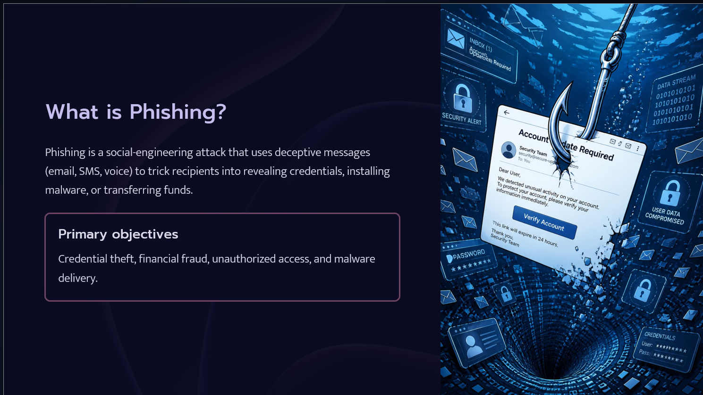

# 🛡️ CodeAlpha - Phishing Awareness Training

## 📖 Overview

This project was developed as part of the **CodeAlpha Cyber Security Internship**.

The purpose of this project is to educate users about phishing attacks, fake websites, social engineering techniques, and cybersecurity best practices. The presentation is designed to raise awareness and help users recognize and avoid common phishing scams.

---

## 🎯 Objectives

- Understand what phishing is.
- Learn different types of phishing attacks.
- Identify phishing emails and fake websites.
- Understand social engineering techniques.
- Follow cybersecurity best practices.
- Learn how to respond to phishing attacks.

---

## 📚 Topics Covered

- Introduction to Phishing
- Types of Phishing
- Identifying Phishing Emails
- Detecting Fake Websites
- Social Engineering
- Real-World Phishing Examples
- Cybersecurity Best Practices
- What to Do if You Become a Victim
- Interactive Quiz
- Summary

---

## 🛠️ Tools Used

- Gamma AI
- Microsoft PowerPoint

---

## 📂 Repository Structure

```
CodeAlpha_PhishingAwarenessTraining/
│
├── README.md
├── Phishing_Awareness_Training.pptx
```

---

## 📸 Presentation Preview





---

## 🎓 Learning Outcomes

After completing this project, learners will be able to:

- Recognize phishing emails.
- Identify fake websites.
- Understand social engineering attacks.
- Apply cybersecurity best practices.
- Protect personal and financial information.

---

## 👩‍💻 Author

**Madiha Israr Bhatti**

BS Information Technology Student

Cyber Security Enthusiast

---

## ⭐ Internship

This project was completed as part of the **CodeAlpha Cyber Security Internship**.
